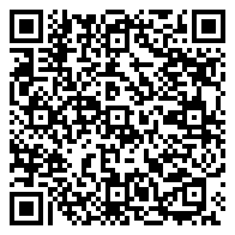

# UniKalender 📅

Bringt den Excel-Stundenplan der **Leibniz-FH** (Wirtschaftsinformatik, dWI) automatisch in den **iPhone-/iCloud-Kalender** und hält ihn aktuell.

Der Stundenplan wird von der Hochschule als Excel-Datei in OneDrive gepflegt und ändert sich laufend. Ausfälle kommen zusätzlich oft morgens per Mail. UniKalender gleicht beides jeden Morgen automatisch mit einem eigenen Kalender ab. So zeigt das iPhone immer den aktuellen Stand.

---

## 📲 Für Kommilitonen: Stundenplan abonnieren, ohne etwas zu installieren

Du willst nur den Stundenplan in deinem Kalender haben? Dann musst du das Tool nicht installieren. Abonniere einfach den fertigen Kalender. Er wird automatisch aktualisiert, sobald sich der Plan ändert oder ein Ausfall per Mail kommt.

> **Inhalt:** Stundenplan **dWI2025, Kohorte A1, Übungsgruppe A1/2**, 3. Semester (WiSe 2026/27).
> Für A1/1 stimmen alle Termine außer *Anwendungen C#* (dort steht Hoffmann statt Arnold). Für A2 passt der Kalender **nicht**.

**Abo-Link:**

```
webcal://p68-caldav.icloud.com/published/2/MTY0MTE3Nzc3NTMxNjQxMZZCOWpAwH43zq2E9-JUoMBNwUgnCkX-6MM-gOkAqJ7LyqGehNRzBCD9pB25BQuUOIiUtwQt-rd8ufx1lr0ZBKY
```



### Am schnellsten: QR-Code scannen (iPhone)
1. Öffne diese Seite am Laptop und richte die **Kamera-App** deines iPhones auf den QR-Code rechts.
2. Tippe auf den gelben Hinweis, der erscheint.
3. Tippe auf **„Abonnieren“** und dann auf **„Fertig“** bzw. **„Hinzufügen“**.

Fertig. Der Kalender erscheint in der Kalender-App.

### iPhone / iPad: Link manuell eintragen
Falls der QR-Code nicht klappt oder du die Seite auf dem iPhone selbst geöffnet hast:

1. Kopiere den **Abo-Link** oben. Auf dem iPhone den grauen Kasten lange drücken → „Kopieren“, oder auf das Kopier-Symbol tippen.
2. Öffne die **Einstellungen**.
3. Scrolle nach unten zu **Apps** → **Kalender** → **Kalenderaccounts**.
   *Bei älteren iOS-Versionen (vor iOS 18): Einstellungen → **Kalender** → **Accounts**.*
4. Tippe auf **„Account hinzufügen“** → **„Andere“** → **„Kalenderabo hinzufügen“**.
5. Füge den Link in das Feld **„Server“** ein und tippe auf **„Weiter“**.
6. Optional: Bei **„Beschreibung“** einen Namen wählen, z. B. `Uni Stundenplan`.
7. Lass **„Erinnerungen entfernen“** eingeschaltet, sonst klingelt dein iPhone vor jeder Vorlesung. Tippe dann auf **„Sichern“**.

### Mac: in der Kalender-App
1. Kopiere den **Abo-Link** oben.
2. Öffne die App **Kalender**.
3. Wähle in der Menüleiste **Ablage → Neues Kalenderabonnement …**
4. Füge den Link ein und klicke auf **„Abonnieren“**.
5. Im folgenden Fenster:
   - **Name:** z. B. `Uni Stundenplan`
   - **Ort:** **iCloud** wählen. Dann erscheint der Kalender automatisch auch auf deinem iPhone und iPad, und du musst ihn dort nicht nochmal hinzufügen.
   - **Automatisch aktualisieren:** **„Alle 15 Minuten“** oder **„Jede Stunde“**
   - Haken bei **„Hinweise entfernen“** und **„Anhänge entfernen“** setzen.
6. Auf **„OK“** klicken.

### Damit Änderungen schnell ankommen
- **iPhone:** Einstellungen → Apps → Kalender → Kalenderaccounts → **Datenabgleich** → **„Abrufen“** auf **„Alle 15 Minuten“** stellen. Bei „Manuell“ aktualisiert sich das Abo nur selten.
- **Sofort aktualisieren:** In der Kalender-App unten auf **„Kalender“** tippen und die Liste **nach unten ziehen**.

### Was du im Kalender siehst
| Eintrag | Bedeutung |
|---|---|
| `WuD – Christmann` | Vorlesung (Kurs-Kürzel – Dozent/in). Den vollen Kursnamen findest du in der Notiz des Termins. |
| Ort **„Online“** | Online-Veranstaltung |
| `❌ ENTFÄLLT: …` | fällt aus (laut Plan oder Uni-Mail) |
| `🎓 Prüfung …` | Klausur |

### Abo wieder entfernen
- **iPhone:** Einstellungen → Apps → Kalender → Kalenderaccounts → **Abonnierte Kalender** → Kalender antippen → **„Account löschen“**.
- **Mac:** In der Kalender-App in der Seitenleiste mit Rechtsklick auf den Kalender → **„Abo kündigen“**.

<details>
<summary><b>Android / Google Kalender</b></summary>

1. Öffne am **Computer** [calendar.google.com](https://calendar.google.com). In der Handy-App geht das nicht.
2. Klicke links neben **„Weitere Kalender“** auf **+** und dann auf **„Per URL“**.
3. Füge den Abo-Link ein und ersetze am Anfang `webcal://` durch `https://`.
4. Klicke auf **„Kalender hinzufügen“**. Nach kurzer Zeit erscheint er auch in der Google-Kalender-App.

⚠️ Google aktualisiert abonnierte Kalender nur etwa alle 12–24 Stunden. Kurzfristige Ausfälle am selben Morgen kommen dort eventuell zu spät an.
</details>

> ℹ️ Der Kalender wird von einem privaten Projekt gepflegt und aktualisiert sich, sobald der Mac des Betreibers morgens läuft. Verbindlich ist immer der offizielle Stundenplan der Hochschule.

---

## Was das Tool kann

- **Liest den Excel-Stundenplan** direkt aus der von OneDrive synchronisierten Datei. Es braucht keine zusätzliche Python-Bibliothek, nur die Standardbibliothek.
- **Versteht die Formatierung des Plans:**
  - Standard-Zeitslots (Vormittag, Nachmittag, Abend) und abweichende Zeiten wie `(18:00-21:15)`
  - Lila Schrift → Ort „Online“
  - Durchgestrichen und rot → `❌ ENTFÄLLT: …`
  - Grün und fett (`K60 …`) → `🎓 Prüfung …`
  - `NEU`-Markierungen und Feiertage (als ganztägige Termine)
- **Filtert nach Übungsgruppe** (z. B. nur `A1/2`).
- **Wertet Uni-Mails aus Apple Mail aus.** Eine Mail wie „leider entfallen heute alle Veranstaltungen von Herrn X am Vormittag“ wird dem passenden Termin zugeordnet. Das Tool erkennt dabei das Datum („heute“, „morgen“, „11.11.“, „am Mittwoch“), den Kurs bzw. die Dozentin oder den Dozenten, den Zeitslot und die Kohorte.
- **Synchronisiert, statt neu anzulegen:** Termine werden aktualisiert oder entfernt, es entstehen keine Duplikate. Vergangene Termine und selbst eingetragene Termine bleiben unangetastet.
- **Sicherheitsnetz:** Liefert die Datei plötzlich viel weniger Termine, bricht das Tool ab, statt den Kalender zu leeren.
- **Läuft automatisch** täglich um 8:00. Ist der Mac zugeklappt, läuft es direkt nach dem Aufklappen.
- **Schickt eine Mac-Benachrichtigung**, wenn sich etwas geändert hat.

## Aufbau

```
OneDrive (Excel)  ─┐
                   ├─►  unikal.py  (Python: Excel parsen, Mails auswerten, Soll-Liste erzeugen)
Apple Mail ────────┘          │
                              ▼
                     unikal  (Swift: EventKit-Sync)  ─►  iCloud-Kalender „Uni“  ─►  iPhone
                              ▲
                  launchd (täglich 8:00 / nach dem Aufwachen)
```

| Datei | Aufgabe |
|---|---|
| `unikal.py` | Logik: Excel lesen (ZIP und XML inkl. Rich-Text-Formatierung), Mails auswerten, Änderungen erkennen |
| `Sources/main.swift` | Systemzugriff: Kalender über EventKit, Mails über AppleScript, Benachrichtigungen |
| `Info.plist` | Begründungstexte für die macOS-Berechtigungen (Kalender, Mail) |
| `install.sh` | Baut den Swift-Helfer, installiert alles und richtet den launchd-Job ein |

**Warum Python und Swift?** macOS vergibt Kalender- und Mail-Berechtigungen pro Programm. Ein kleines, signiertes Swift-Programm mit eigener `Info.plist` bekommt diese Berechtigungen zuverlässig, auch wenn es im Hintergrund über launchd läuft. Python übernimmt die Auswertung, weil sich das dort einfacher testen lässt.

## Installation

Voraussetzungen: macOS 14+, Xcode Command Line Tools (`xcode-select --install`), Python 3 (z. B. über Homebrew), die OneDrive-App mit Uni-Konto und Apple Mail mit Uni-Konto (optional).

```bash
git clone https://github.com/<dein-name>/UniKalender.git
cd UniKalender
./install.sh
```

Danach in `~/Library/Application Support/UniKalender/config.json` eintragen:

| Feld | Bedeutung |
|---|---|
| `xlsxPath` | Pfad zur synchronisierten Stundenplan-Datei (siehe [ANLEITUNG.md](ANLEITUNG.md)) |
| `group` | deine Übungsgruppe, z. B. `A1/2` |
| `jahrgang` | z. B. `2025`. Mails für andere Jahrgänge werden ignoriert. |
| `calendarName` | Name des Kalenders, der angelegt wird (Standard: `Uni`) |
| `mailSenderFilter` | Nur Mails von diesem Absender bzw. dieser Domain werden gelesen. |
| `settleSeconds` | Wartezeit nach dem Aufwachen, damit OneDrive die neueste Datei holt (Standard: 90) |

Ersten Lauf starten. macOS fragt dabei nach den Berechtigungen für Kalender, Mail und OneDrive:

```bash
launchctl kickstart gui/$(id -u)/local.unikalender
```

Die ausführliche Schritt-für-Schritt-Anleitung (OneDrive-Verknüpfung, Bedienung, Deinstallation) steht in **[ANLEITUNG.md](ANLEITUNG.md)**.

## Eigenen Kalender mit anderen teilen

Wenn du das Tool selbst betreibst, kannst du deinen iCloud-Kalender „Uni“ auf dem iPhone unter Kalender → ⓘ → **Öffentlicher Kalender** freigeben. Den Link können andere so abonnieren, wie es [oben](#-für-kommilitonen-stundenplan-abonnieren-ohne-etwas-zu-installieren) beschrieben ist.

## Grenzen

- Das Tool läuft auf dem **Mac**. Ist der Mac zugeklappt, läuft der Abgleich erst beim Aufklappen. Eine reine Cloud-Lösung scheitert daran, dass die Hochschule externen Apps keinen Zugriff auf OneDrive erlaubt (Administratorgenehmigung erforderlich).
- Das Tool ist auf das Format der Leibniz-FH-Stundenpläne zugeschnitten. Andere Hochschulen bräuchten einen angepassten Parser.
- Die Mail-Auswertung arbeitet mit Regeln, nicht mit KI. Ungewöhnlich formulierte Mails werden nicht zugeordnet. Das Tool meldet sie dann aber als „bitte selbst prüfen“.

## Lizenz

MIT – siehe [LICENSE](LICENSE).
